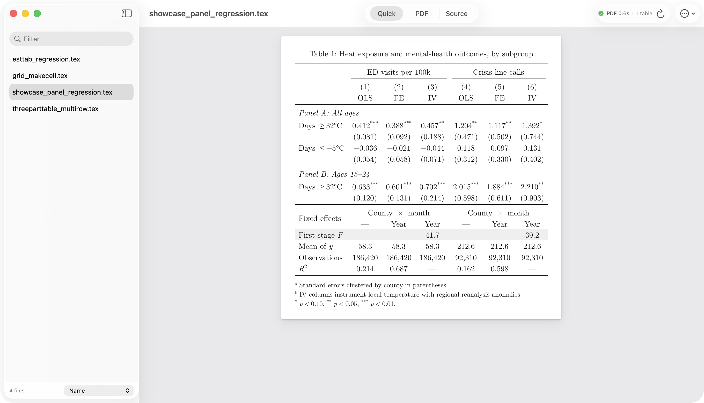
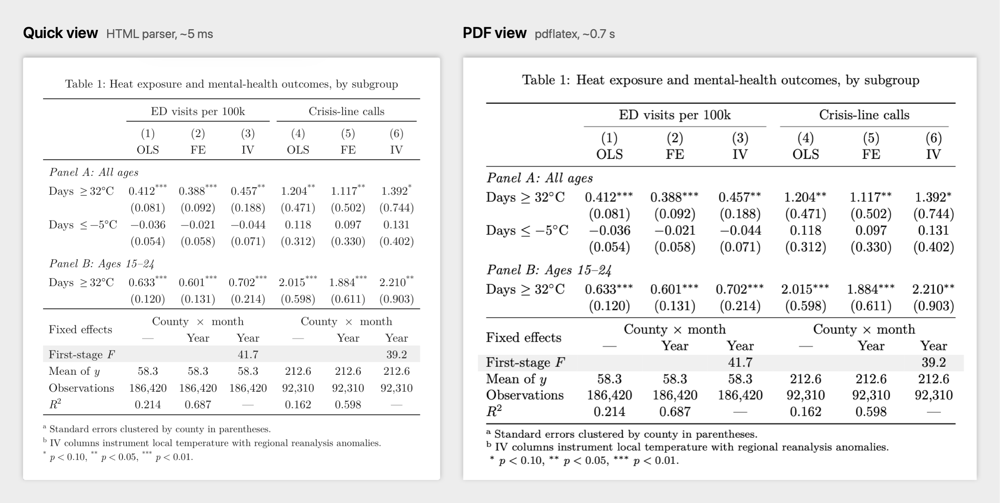

# TablePeek

A small macOS app for previewing LaTeX tables stored as `.tex` files, with no manual compile step.



The same table ([Examples/showcase_panel_regression.tex](Examples/showcase_panel_regression.tex)) in the instant quick view and the real `pdflatex` output:



- **Quick view** (instant, about 5 ms): a best-effort parser turns `tabular`-style environments into HTML, typeset in Latin Modern. It handles booktabs rules (`\toprule`, `\cmidrule(lr){2-3}`, …), `\hline`/`\cline`, vertical rules, `\multicolumn`, `\multirow`, `\makecell`/`\shortstack`, `\sym{}` (esttab), inline math, colors, captions, `threeparttable` notes, simple user macros, nested tabulars, and longtable heads and feet.
- **PDF view** (the real output): the file is compiled with `pdflatex`/`xelatex`/`lualatex` in the background as soon as you select it. Fragments are wrapped in an article-like page (6.5in `\textwidth`, common table packages preloaded) and cropped to the ink. Files that contain `\documentclass` are compiled as they are.
- **Cache**: PDFs are stored by content hash in `~/Library/Caches/TablePeek`, so a table you've already seen opens instantly. When you open a folder, its 60 most recently modified files are pre-rendered in the background (2 at a time).
- **Live reload**: the opened folder is watched with FSEvents. If a script rewrites a table, both views update automatically, and new files appear in the sidebar.
- **Source view** shows the raw LaTeX.
- **Finder Quick Look**: select a `.tex` file and press **Space** to see the quick table preview without opening the app. This comes from a Quick Look extension bundled inside the app.

If you select PDF mode while a PDF is still compiling, you see the quick view with a "Compiling…" badge, and it switches over when the PDF is ready. LaTeX errors show as a banner (nonstopmode still produces a PDF) or as a failure page with the log. Line numbers refer to your file.

## Install

Download the latest `TablePeek-x.y.z.zip` from [Releases](https://github.com/SimonMTaye/TablePeek/releases), unzip it, and move `TablePeek.app` to `/Applications`. It runs on Apple Silicon Macs with macOS 14+.

The app is signed ad hoc, not notarized, so macOS blocks the first launch ("Apple could not verify…"). Allow it under **System Settings → Privacy & Security → Open Anyway**, or run:

```bash
xattr -dr com.apple.quarantine /Applications/TablePeek.app
```

The PDF view needs a TeX distribution such as [MacTeX](https://tug.org/mactex/); the app looks in `/Library/TeX/texbin`, `/opt/homebrew/bin` and `/usr/local/bin`. The quick view and the spacebar preview work without it.

## Build from source

Needs the Swift toolchain. The Command Line Tools are enough; Xcode is not needed, not even for the Quick Look extension, which is built with plain `swiftc` and signed ad hoc.

```bash
./scripts/build-app.sh            # -> build/TablePeek.app
./scripts/build-app.sh --install  # also copies to ~/Applications
./scripts/release.sh              # build + zip -> build/TablePeek-<version>.zip
./scripts/release.sh --publish    # ...and create the GitHub release (tag v<version>)
```

To cut a new release, bump `CFBundleShortVersionString` in `Resources/Info.plist` and `QuickLook/Info.plist`, update `scripts/release-notes.md`, and run `scripts/release.sh --publish`.

During development: `swift run TablePeek path/to/folder-or-file.tex`.

If the spacebar preview doesn't appear after installing, run `qlmanage -r` and relaunch Finder (⌥-right-click its Dock icon → Relaunch). Also check that "TablePeek Quick Look" is enabled under System Settings → General → Login Items & Extensions → Quick Look.

## Usage

- Open a folder or `.tex` file with **⌘O**, drag it onto the window, or `open -a TablePeek table.tex`. The app also registers as an alternate "Open With" handler for `.tex`.
- Opening a single file browses its folder, so you can arrow through sibling tables.
- The last folder is restored on launch.

| Shortcut | Action |
|---|---|
| ⌘1 / ⌘2 / ⌘3 | Quick / PDF / Source |
| ⇧⌘T | Toggle Quick ↔ PDF |
| ↑ ↓ (sidebar) or ⌘↑ / ⌘↓ | Previous / next file |
| ⌘R | Force recompile (bypasses the cache) |
| ⌘+ / ⌘− / ⌘0 | Zoom (both views; pinch also works) |
| ⌘E | Open in editor (configurable in Settings) |
| ⇧⌘P | Open the compiled PDF in Preview |
| ⇧⌘R | Reveal in Finder |

The sidebar can be sorted by name or by **recently modified**, which is handy when a script has just regenerated outputs.

**Settings (⌘,)**: TeX engine, `\textwidth` for fragments, extra preamble for project macros and packages (e.g. `\newcommand{\sym}…`, `\usepackage{…}`), the pre-render toggle, the editor app, and clearing the cache.

## CLI

`build/TablePeek.app/Contents/MacOS/tablepeek-cli` exposes the same pipeline:

```bash
tablepeek-cli table.tex out.html     # quick parser -> standalone HTML
tablepeek-cli --pdf table.tex        # compile (cached) and print the PDF path + errors
```

## Layout

```
Sources/TablePeekCore/   parser (LatexScanner, InlineConverter, TableParser), HTMLRenderer, PDFRenderer (compile/cache/crop)
Sources/TablePeek/       SwiftUI app (AppModel, views, FSEvents watcher)
Sources/tablepeek-cli/   command-line front end
QuickLook/               Finder spacebar preview extension (reuses the parser sources)
Examples/                sample tables
docs/                    README screenshots
scripts/                 build-app.sh, release.sh, make-icon.swift
```

## Limitations

- The quick parser is regex/scanner based. It approximates layout: no decimal alignment for `S`/`D` columns, no `tabularray` (`tblr`) syntax, and macros with complex arguments are dropped and their last argument kept.
- `\input` paths and graphics resolve relative to the table's own folder.
- The Quick Look preview only shows the quick (parsed) view, since the sandboxed extension can't run LaTeX.
- The app is signed ad hoc, not with an Apple Developer ID, so it isn't notarized (see Install above).
