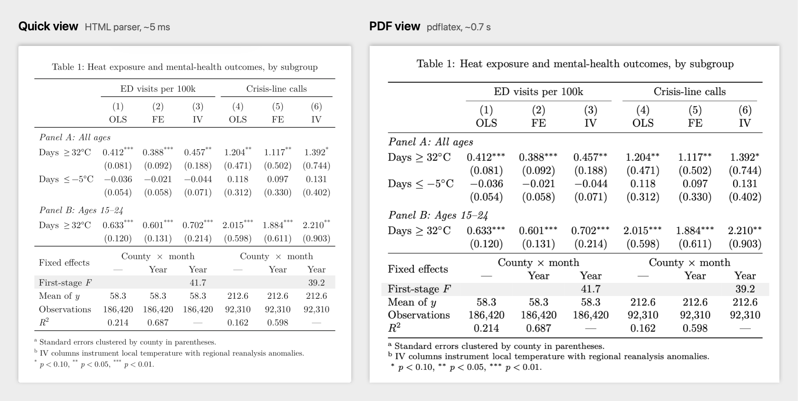

A macOS app for previewing LaTeX `.tex` tables: an instant parsed HTML view, a real `pdflatex` render in the background, and a Finder spacebar (Quick Look) preview.

### Install

1. Download **TablePeek-VERSION.zip** below, unzip it, and move `TablePeek.app` to `/Applications`.
2. The app isn't notarized by Apple, so the first launch is blocked with "Apple could not verify…". To allow it, either:
   - open **System Settings → Privacy & Security**, scroll down, and click **Open Anyway** next to TablePeek, or
   - run `xattr -dr com.apple.quarantine /Applications/TablePeek.app` in Terminal.
3. Launch it once so Finder picks up the spacebar preview for `.tex` files. If it doesn't appear, run `qlmanage -r` and enable "TablePeek Quick Look" under System Settings → General → Login Items & Extensions → Quick Look.

### Requirements

- macOS 14 or later on an Apple Silicon Mac.
- A TeX distribution such as [MacTeX](https://tug.org/mactex/) for the PDF view. The quick view and the spacebar preview work without it.
